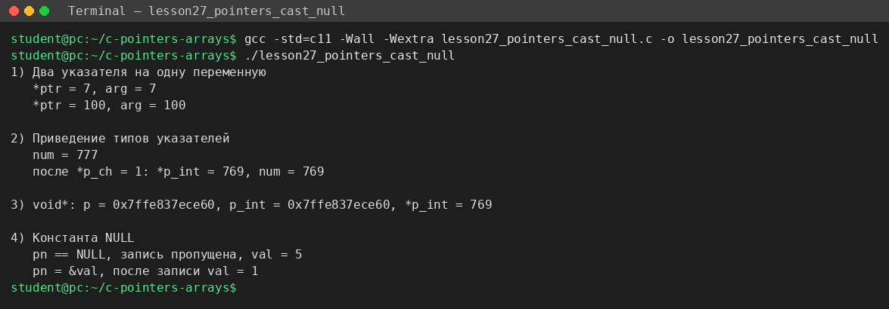
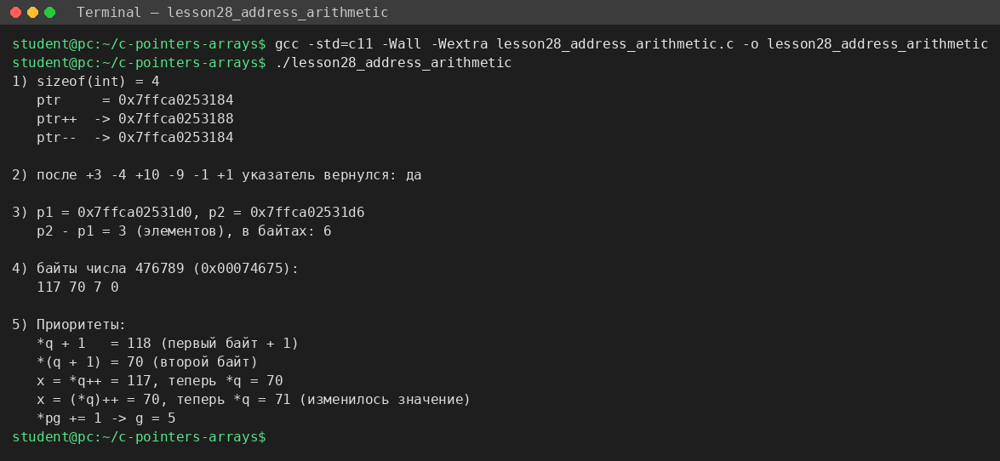
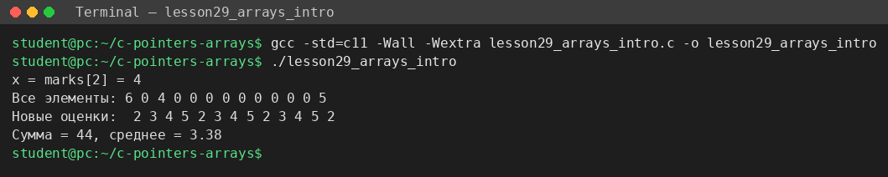
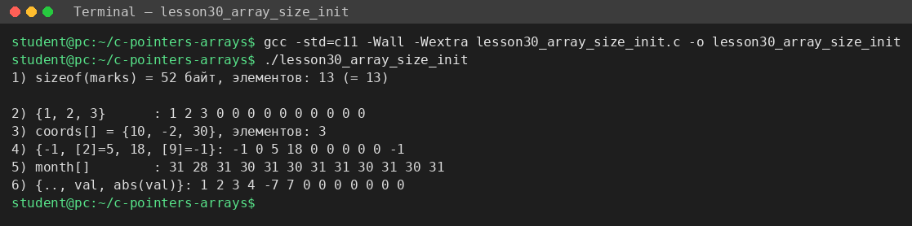
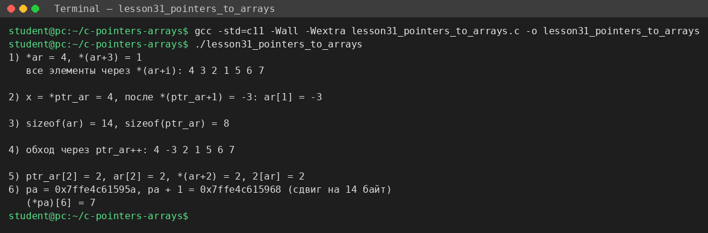

# Указатели и массивы в Си

Дистанционное обучение от 20.11.2026. Программы по видеоурокам SelfEdu
(Сергей Балакирев, «Язык C для начинающих», #27–#31).

| Урок | Файл | Что показано |
|---|---|---|
| #27 Указатели. Приведение типов. Константа NULL | `lesson27_pointers_cast_null.c` | два указателя на одну переменную, приведение `int*` → `char*`, `void*`, проверка на `NULL` |
| #28 Адресная арифметика | `lesson28_address_arithmetic.c` | `ptr++`/`ptr--`, сложение с целым, разность указателей, побайтовый просмотр `int`, приоритеты `*ptr++`, `(*ptr)++`, `*(ptr+1)` |
| #29 Введение в массивы | `lesson29_arrays_intro.c` | объявление, запись и чтение элементов, вывод в цикле, сумма и среднее |
| #30 Размер массива. Инициализация | `lesson30_array_size_init.c` | `sizeof(a)/sizeof(*a)`, полная и частичная инициализация, `int a[] = {...}`, назначенные инициализаторы C99, глобальный массив |
| #31 Указатели на массивы | `lesson31_pointers_to_arrays.c` | `*(ar+i)`, указатель на первый элемент, `sizeof` массива и указателя, `ptr[i]` и `2[ar]`, указатель на весь массив `short (*)[7]` |

## Компиляция и запуск

    gcc -std=c11 -Wall -Wextra lesson27_pointers_cast_null.c -o lesson27
    ./lesson27

Все программы компилируются без предупреждений.

## Скриншоты выполнения

Адреса в выводе при каждом запуске разные — это нормально.

### #27 Указатели. Приведение типов. NULL

### #28 Адресная арифметика

### #29 Введение в массивы

### #30 Размер массива. Инициализация

### #31 Указатели на массивы

